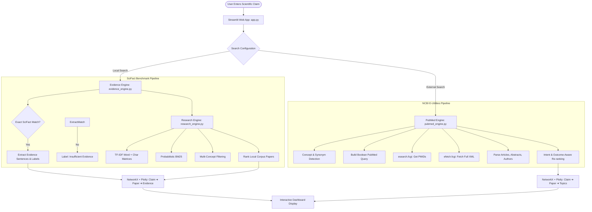

# 🔬 ResearchTrace: AI-Powered Scientific Claim Discovery & Evidence Exploration

[](https://www.python.org/)
[](https://streamlit.io/)
[](https://scifact.allenai.org/)
[](https://pubmed.ncbi.nlm.nih.gov/)
[]()

> **ResearchTrace** is an intelligent scientific claim verification and biomedical literature discovery platform. It combines curated benchmark evidence annotations from the **SciFact** dataset with real-time, live retrieval from **NCBI PubMed**, visualizing claim-paper-evidence relationships through interactive knowledge graphs.

**Developed by:** Lucky Jain & Shruti Rajak  
**Institution:** NMIMS, Navi Mumbai  

---

## 📑 Table of Contents

1. [Overview & Motivation](#-overview--motivation)
2. [Key Capabilities & Features](#-key-capabilities--features)
3. [System Architecture](#-system-architecture)
4. [File & Project Structure](#-file--project-structure)
5. [Quickstart Guide for VS Code](#-quickstart-guide-for-vs-code)
   - [Opening in VS Code](#1-open-the-project-in-vs-code)
   - [Virtual Environment Activation](#2-activate-the-virtual-environment)
   - [Dependencies Installation](#3-install-dependencies)
   - [Running the Web Application](#4-launch-the-streamlit-application)
   - [Viewing & Editing Markdown in VS Code](#5-viewing-this-readme-in-vs-code)
6. [Detailed Module Breakdown](#-detailed-module-breakdown)
   - [`app.py` (UI & Dashboard)](#1-apppy)
   - [`evidence_engine.py` (SciFact Stance Analysis)](#2-evidence_enginepy)
   - [`research_engine.py` (Hybrid Search Engine)](#3-research_enginepy)
   - [`pubmed_engine.py` (NCBI Entrez Live Retriever)](#4-pubmed_enginepy)
   - [Utility & Diagnostic Scripts](#5-utility--diagnostic-scripts)
7. [Search & Retrieval Mechanics](#-search--retrieval-mechanics)
   - [Hybrid Retrieval Formula](#hybrid-local-ranking-formula)
   - [Concept Ontologies & Query Expansion](#scientific-concept-ontologies)
   - [PubMed Intent & Outcome Ranking](#pubmed-intent-aware-ranking)
8. [Example Test Claims](#-example-test-claims)
9. [Important Scientific Disclaimers](#-important-scientific-disclaimers)
10. [Authors & Contact](#-authors--contact)

---

## 🌟 Overview & Motivation

In an era of rapid scientific publishing and prevalent health misinformation, verifying claims against peer-reviewed literature is critical. Traditional keyword search engines often retrieve papers that merely share vocabulary with a query without addressing the underlying clinical hypothesis or distinguishing between:
- **Prevention vs. Treatment** (e.g., preventing the common cold vs. shortening its duration)
- **Direct Evidence vs. Background Context** (e.g., general reviews vs. randomized controlled trials)
- **Support vs. Refutation** (e.g., consensus findings vs. debunked correlations)

**ResearchTrace** bridges this gap using a **dual-engine architecture**:
1. **Local Benchmark Engine (SciFact)**: Provides rigorous, sentence-level expert-annotated evidence citations that explicitly evaluate claims as `SUPPORTS`, `REFUTES`, or `INSUFFICIENT EVIDENCE`.
2. **Global Real-Time Engine (PubMed)**: Queries the National Center for Biotechnology Information (NCBI) Entrez E-Utilities API in real-time, executing smart Boolean query expansion and intent-aware re-ranking.
3. **Interactive Knowledge Graphs**: Maps claims, literature, and evidence sentences in dynamic force-directed network graphs using NetworkX and Plotly.

---

## 🚀 Key Capabilities & Features

### 1. Dual-Track Investigation
* **Local SciFact Research Tab**: Evaluates claims against 1,000+ annotated scientific claims and 5,000+ scientific abstracts from the Allen Institute for AI's SciFact corpus.
* **Live PubMed Research Tab**: Live queries millions of peer-reviewed biomedical abstracts from the National Library of Medicine (NLM/NCBI).

### 2. High-Precision Hybrid Local Search
* **Multi-Representation Vectorization**: Employs word-level n-gram TF-IDF (unigrams & bigrams) on titles and abstracts, alongside sub-word character n-grams (`char_wb` 3–5) for typo and morphological tolerance.
* **Lexical BM25 Scoring**: Full Probabilistic BM25 implementation (`k1=1.5, b=0.75, k3=8.0`) to reward exact biomedical terms.
* **Domain-Specific Concept Ontologies**: Automatic phrase detection for scientific entities (e.g., Creatine, Gut Microbiome, Vitamin C, Lung Cancer, Prions).
* **Multi-Facet Co-occurrence Filtering**: Ensures candidate papers discuss both the primary intervention and the target outcome/condition, rather than irrelevant generic matches.

### 3. Smart PubMed Query Synthesis & Ranking
* **Automated Boolean Query Builder**: Converts natural language claims into targeted queries incorporating Title/Abstract tags and MeSH (Medical Subject Headings) terms.
* **Outcome Intent Matching**: Detects clinical intent (prevention, treatment, duration, severity, safety, performance).
* **Penalty-Based Re-ranking**: Demotes treatment papers when a prevention claim is investigated (e.g., ensuring cold treatment trials do not masquerade as proof of cold prevention).

### 4. Interactive Knowledge Network Visualization
* **Force-Directed Graph Layouts**: Built using NetworkX (`spring_layout`) and Plotly Graph Objects.
* **Visual Node Hierarchy**:
  - `◆ Purple Diamond`: Central scientific claim.
  - `● Cyan Circle`: Retrieved peer-reviewed research papers.
  - `● Green Circle`: Annotated evidence sentences with stance labels.
  - `⬡ Pink Hexagon`: Inferred biomedical topics & MeSH categories.
* **Interactive Controls**: Pan, zoom, hover tooltips, and one-click high-resolution PNG export.

### 5. Cyberpunk-Inspired Glassmorphic UI
* Custom-crafted dark aesthetic using high-contrast typography (`DM Mono` + `Inter`), glowing accent borders, responsive metric cards, expandable abstract readers, and direct external DOI/PubMed links.

---

## 🏗 System Architecture



---

## 📁 File & Project Structure

```
ResearchTrace/
├── data/
│   ├── claims_train.jsonl         # SciFact training set with claim annotations and evidence indices
│   └── corpus.jsonl               # SciFact corpus containing 5,183 research paper abstracts
├── .venv/                         # Python 3.14 virtual environment containing installed packages
├── app.py                         # Streamlit UI application with dark theme, tabs & graphs
├── evidence_engine.py             # SciFact annotation evaluator & verdict determination logic
├── research_engine.py             # Hybrid local search engine (TF-IDF, BM25, query expansion)
├── pubmed_engine.py               # NCBI Entrez API client, XML parser & outcome-aware ranker
├── data_loader.py                 # Dataset downloader & extractor from AllenAI S3 storage
├── diagnose_local_relevance.py    # Diagnostic script for corpus concept coverage checks
├── inspect_data.py                # Inspection script for reading raw SciFact JSONL records
├── show_test_claims.py            # Utility displaying pre-verified test claims for all verdicts
├── requirements.txt               # List of core Python dependencies
└── README.md                      # Project documentation and guide (this file)
```

---

## 💻 Quickstart Guide for VS Code

Follow these step-by-step instructions to run and explore ResearchTrace within Visual Studio Code.

### 1. Open the Project in VS Code
1. Launch **Visual Studio Code**.
2. Open the project folder:
   - Click **File > Open Folder...** (or press `Ctrl+K Ctrl+O`).
   - Navigate to `C:\Users\jainl\ResearchTrace` and click **Select Folder**.

### 2. Activate the Virtual Environment
Open the integrated terminal in VS Code:
- Press `Ctrl + ~` (or select **Terminal > New Terminal** from the top menu).
- In PowerShell, activate the existing virtual environment:
  ```powershell
  .\.venv\Scripts\Activate.ps1
  ```
  *(If your terminal displays `(.venv)` before the prompt, activation was successful).*

> **Tip:** If PowerShell restricts script execution, run:
> ```powershell
> Set-ExecutionPolicy -Scope Process -ExecutionPolicy Bypass
> .\.venv\Scripts\Activate.ps1
> ```

### 3. Install Dependencies
If you need to install or update the packages, run:
```powershell
pip install -r requirements.txt
```

Core libraries installed:
- `streamlit`: Interactive web UI framework.
- `pandas` & `numpy`: High-performance data manipulation and numerical operations.
- `scikit-learn`: Feature extraction (`TfidfVectorizer`, `CountVectorizer`, cosine distance).
- `networkx`: Graph data structure and network topology algorithms.
- `plotly`: WebGL/SVG interactive charting and graph rendering.

### 4. Launch the Streamlit Application
In the activated terminal, run:
```powershell
streamlit run app.py
```

Streamlit will initialize the server and display:
```
  You can now view your Streamlit app in your browser.

  Local URL: http://localhost:8501
  Network URL: http://192.168.x.x:8501
```
The application will automatically open in your default web browser.

### 5. Viewing this README in VS Code
VS Code includes a built-in Markdown previewer:
- Open `README.md` in the VS Code editor.
- Press `Ctrl + Shift + V` to open the full rendered preview.
- Or press `Ctrl + K` followed by `V` to open side-by-side split preview.

---

## 🔍 Detailed Module Breakdown

### 1. `app.py`
The primary application entry point:
* **Theming**: Employs custom CSS injections with glassmorphism, glowing gradients, and responsive breakpoints.
* **State Management**: Uses `st.session_state` to cache search results, selected tabs, paper keys, and user selections across re-renders.
* **Dual Tabs**:
  - `01 · LOCAL RESEARCH`: Renders verdict banners, confidence notes, summary metrics, interactive force-directed graph, paper selector, evidence sentence viewer, and paper cards.
  - `02 · PUBMED RESEARCH`: Renders live search results, publication metadata, match signal badges, external PubMed graph, and raw NCBI query inspector.
* **Error Resilience**: Gracefully handles network timeouts, empty result sets, and malformed inputs.

### 2. `evidence_engine.py`
Evaluates claims against the ground-truth annotations of SciFact:
* **Normalization**: Strips excess whitespace, normalizes Unicode NFKC, and lowercases text for exact matching.
* **Evidence Extraction**: Resolves sentence indices in `claims_train.jsonl` against abstract sentence arrays in `corpus.jsonl`.
* **Verdict Synthesis**:
  - `SUPPORTS`: Claims with exclusively supporting evidence sentences.
  - `REFUTES`: Claims with exclusively contradicting evidence sentences.
  - `MIXED EVIDENCE`: Claims where studies provide both supporting and contradictory findings.
  - `INSUFFICIENT EVIDENCE`: Unannotated or exploratory claims lacking ground-truth labels.
* **Source Guarantee**: Guarantees that cited source papers appear in the result set even if statistical retrieval assigns them lower ranks.

### 3. `research_engine.py`
The core information retrieval engine over `data/corpus.jsonl`:
* **Corpus Ingestion**: Deduplicates 5,000+ papers, formats search indices, and precomputes lowercased strings.
* **Composite Vectorization**:
  - Title TF-IDF Matrix (1–2 n-grams, sublinear scaling).
  - Abstract TF-IDF Matrix (1–2 n-grams, sublinear scaling).
  - Character n-gram Matrix (3–5 n-grams, character-level boundaries).
  - Count Matrix & BM25 length-normalization parameters.
* **Concept Matching**: Maps domain-specific aliases (e.g., *phosphocreatine* ➔ *creatine*, *rhinovirus* ➔ *common cold*).
* **Multi-Facet Co-occurrence Filter**: Enforces that candidate documents contain both intervention and condition/outcome tokens, preventing false positives from topic bleed.

### 4. `pubmed_engine.py`
Live interface to the NCBI Entrez API:
* **Query Building**: Generates strict Boolean queries combining primary concepts with secondary outcome clauses (e.g., `("vitamin C"[Title/Abstract]) AND ("common cold"[Title/Abstract])`).
* **XML Extraction**: Parses structured MEDLINE XML into clean JSON records (PMID, title, structured abstracts, author lists, journal name, publication date).
* **Display Ranking**: Ranks retrieved papers using title matches, outcome indicators, review boosts, and prevention-vs-treatment penalty checks.
* **Rate-Limiting & Caching**: Employs `@lru_cache` and polite request intervals to comply with NCBI usage guidelines.

### 5. Utility & Diagnostic Scripts
* **`show_test_claims.py`**: Reads `claims_train.jsonl` and outputs pre-verified test claims guaranteed to trigger `SUPPORTS`, `REFUTES`, and `INSUFFICIENT EVIDENCE` in the local engine.
* **`diagnose_local_relevance.py`**: Performs tier-based diagnostic scans across `corpus.jsonl` to assess topic coverage for specific claims.
* **`inspect_data.py`**: Dumps formatted sample claim records, evidence indices, and cited document IDs.
* **`data_loader.py`**: Downloads and unpacks the official SciFact dataset archive directly from AllenAI S3.

---

## ⚙️ Search & Retrieval Mechanics

### Hybrid Local Ranking Formula
The similarity score $S(d, q)$ for document $d$ and query $q$ is computed as:

$$
\begin{aligned}
S(d, q) =\ & 0.24 \cdot \text{TFIDF}_{\text{Title}}(q) + 0.22 \cdot \text{TFIDF}_{\text{Abstract}}(q) \\
+\ & 0.10 \cdot \text{TFIDF}_{\text{Title}}^{\text{Expanded}}(q) + 0.08 \cdot \text{TFIDF}_{\text{Abstract}}^{\text{Expanded}}(q) \\
+\ & 0.05 \cdot \text{TFIDF}_{\text{Char}}(q) + 0.13 \cdot \text{BM25}(d, q) \\
+\ & 0.13 \cdot \text{Score}_{\text{Topic}}(d, q) + 0.05 \cdot \text{Coverage}_{\text{Terms}}(d, q)
\end{aligned}
$$

> **Note:** The ranking score represents textual relevance and topic overlap. It is **not** a probability of scientific truth.

### Scientific Concept Ontologies
The engine maintains built-in biomedical concept dictionaries:
* **Creatine & Performance**: *creatine monohydrate, phosphocreatine, resistance training, muscle strength.*
* **Cognition & Neurological**: *cognitive performance, memory, brain function, neuroprotection.*
* **Gut Microbiome & Health**: *intestinal microbiota, gut-brain axis, microbial communities, digestion.*
* **Vitamins & Micronutrients**: *vitamin C, ascorbic acid, cholecalciferol (vitamin D), folate, homocysteine.*
* **Pathology & Disease**: *lung neoplasms, pulmonary carcinoma, prions, PrPSc, rhinoviruses.*

### PubMed Intent-Aware Ranking
When ranking PubMed results, the engine adjusts relevance based on clinical aspects:
* `+12.0` Intervention match in title
* `+5.0` Direct claim outcome in paper title (e.g. *prevention*, *safety*, *treatment*)
* `+3.0` Title directly links intervention and outcome
* `+1.0` Systematic review or meta-analysis publication
* `-6.0` **Mismatched outcome penalty**: applied when investigating a prevention claim but the paper focuses strictly on treatment/symptom reduction without assessing incidence.

---

## 🧪 Example Test Claims

Use these sample claims to test each feature of ResearchTrace. You can copy-paste them directly into the search bar:

### 1. SciFact Benchmark Claims (Local Research Tab)
| Target Verdict | Claim Text | Source / Topic |
|---|---|---|
| **SUPPORTS** | `32% of liver transplantation programs required patients to discontinue methadone treatment in 2001.` | SciFact Training Claim #3 |
| **REFUTES** | `1 in 5 million in UK have abnormal PrP positivity.` | SciFact Training Claim #4 |
| **INSUFFICIENT EVIDENCE** | `0-dimensional biomaterials lack inductive properties.` | SciFact Training Claim #1 |

### 2. General Biomedical Claims (PubMed Research Tab)
* **Vitamin C & Common Cold**:  
  `Vitamin C supplementation prevents the common cold.`  
  *(Observe how the PubMed ranker distinguishes between cold prevention trials and cold duration/treatment studies).*
* **Creatine & Brain Function**:  
  `Creatine supplementation improves cognitive performance and memory.`  
  *(Retrieves clinical trials and systematic reviews examining nootropic effects of creatine).*
* **Gut-Brain Axis & Mental Health**:  
  `The gut microbiome influences mood, depression, and anxiety via the gut-brain axis.`  
  *(Demonstrates multi-topic graph connections between gastrointestinal flora and neuropsychiatric outcomes).*

---

## ⚠️ Important Scientific Disclaimers

1. **Dataset-Dependent Verdicts**: The verdicts displayed in the Local Research tab reflect the specific annotations of the **SciFact** dataset. They reflect the conclusions of the authors of the annotated papers, not absolute truth.
2. **Text Similarity $\neq$ Evidence Stance**: High similarity scores indicate that a paper shares terms and concepts with the claim. A paper with a 0.85 similarity score may strongly dispute the claim.
3. **Clinical Interpretation**: PubMed search results are not medical advice. Evaluating scientific truth requires analyzing study design (in vitro vs. animal vs. randomized human clinical trials), dosage, sample size, risk of bias, and replication across independent laboratories.

---

## 👥 Authors & Contact

* **Lucky Jain** — *Research, Interface Engineering & Engine Development*
* **Shruti Rajak** — *Research, Engine Development & Interface Engineering*
* **Institution**: SVKM's NMIMS (Narsee Monjee Institute of Management Studies), Navi Mumbai Campus

*Built with Python, Streamlit, SciFact, NCBI PubMed, NetworkX, and Plotly.*
